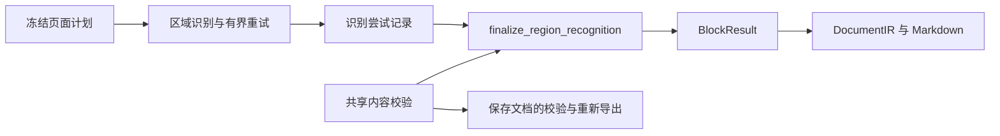

# 区域识别结果

第 2 项结构优化把实时区域的完成证据判定、内容规范化、无效字节保存和错误优先级集中到 `block_result` 模块。`page_execution` 负责调度、取消、进度与后端可用性，调用 `finalize_region_recognition(type, recognition)` 得到区域内容结果。



通用后端的结果处理现也通过 `finalize_generic_recognition` 集中到本模块，保持旧完成/截断与 UTF-8 规则；不会应用 PP 的视觉证据和公式/表格规范化。页面阶段组合见 [页面 pipeline](page-pipeline.md)。

## 文件职责

| 文件 | 职责 |
|---|---|
| `src/block_result.hpp` | 区域内容结果与单一规范化入口；结果不包含页面几何、块身份或资源存储 |
| `src/block_result.cpp` | 选取最后一次尝试，完成正文、公式和表格规范化、完成证据判定、来源保存和错误覆盖 |
| `src/content_validation.cpp` | 已有 `content_validation.hpp` 的独立实现：公式、正文数学片段、表格数学内容与历史来源匹配 |
| `src/output_assessment.cpp` | 完成度、视觉证据、重复与异常编号判定，供结果规范化和重试规则复用 |
| `src/output_encoding.hpp` | 原样复用 UTF-8 校验和 Base64 编码，供结果、尝试记录及序列化共用 |
| `src/page_execution.cpp` | 区域调度、取消/进度与后端可用性；调用内容结果模块，返回块与暂存资源 |
| `tests/block_result.cpp` | 通过规范化入口直接验证内容与错误组合，不需要模型或图像 |

## 结果约定

- 结果基于最后一次识别尝试；规范化不执行推理、reset 或重试，不修改尝试历史或原始输出。
- 正文保留原文并检查数学片段；单一公式移除包装并记录显示模式；混合公式保留文字与公式顺序；正常表格提供规范化 HTML 和结构化单元格。
- 原始输出独立保存。无效 UTF-8 的 raw、text、error 分别保留 Base64；无效字节不直接写入 JSON 文本。
- 完成证据先判定，再检查内容语法，随后应用编码错误与后端异常的覆盖规则。最终块状态、assessment 状态和错误原因保持一致。
- 未成功的表格清空展示文字和结构化单元格，保留原始输出、判定依据及裁剪资源引用。其他内容仍由 Markdown 的现有状态展示规则处理。
- 页面计划、块身份、裁剪和顺序不参与内容判定，也不随内容结果修改。

## 保持的策略差异

有界重试仍由 `region_recognition.cpp` 基于完成度和视觉证据决定，不根据内容语法新增重试。保存文档的 schema 约束、可重新核验状态及写回策略仍由 `reexport.cpp` 处理。

共享数学规则原样迁移：当前识别、展示和显式重验使用严格脚本校验；历史来源匹配仍使用既有兼容规则。通用 fixture 执行路径保留原有完成判断及错误文案。

## 验证

直接测试覆盖正文、单一与混合公式、表格规范化、语法失败、无视觉证据、截断、重复、未知停止原因、三个字段各自的编码错误、错误覆盖顺序、reset 与返回类型错误、最后一次尝试及输入不变性。

2026-10-11 对本轮重构前后进行了 28 组端到端对照，覆盖正常、截断、异常、混合公式、表格、reset、无效编码和重试。排除实际耗时字段后，完整 DocumentIR、Markdown、run-manifest 与全部资源 SHA256 一致；识别预算等配置字段参与比较。

Release 无模型构建的 36 项 CTest 全部通过，包含新增 `block_result` 直接测试、页面计划、旧文档重新核验、PDF、取消、重试与作业控制。本轮 `core.cpp` 从 2167 行减少到 1660 行。

运行命令与测试环境见 [页面计划验证](page-plan.md)。新增入口测试可单独运行：

```sh
ctest --test-dir /tmp/docprase-page-plan-check -R '^block_result$' --output-on-failure
```

本轮属于结构与行为回归验证，未评测真实模型质量、推理性能或 Android 真机表现。
