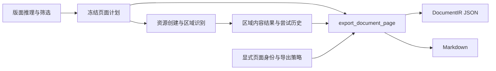

# 页面文档导出

第 3 项结构优化将实时页面的 DocumentIR 序列化、Markdown 组织及识别后的语义关联从 `core.cpp` 集中到 `document_export` 模块。调用方通过 `export_document_page(PageDocumentInput)` 同时取得 JSON 和 Markdown，不再传递原来的 16 个位置参数。



## 文件职责

| 文件 | 职责 |
|---|---|
| `src/document_export.hpp` | 页面元信息、导出块、可选版面证据和统一导出入口 |
| `src/document_export.cpp` | 冻结顺序的读取、标题/表注/脚注关联、DocumentIR 与 Markdown 生成，以及共享的识别历史序列化 |
| `src/layout_candidate.hpp` | 筛选和导出诊断共用候选记录，保存几何与资源引用，不持有像素或张量 |
| `src/page_pipeline.cpp` | 组合候选筛选、复核、冻结计划、区域执行和文档导出，负责预算与资源提交 |
| `src/markdown.cpp` | 单块展示与数学转义；实时导出和保存文档的重新导出继续共用 |
| `tests/document_export.cpp` | 直接通过导出入口检查顺序、页身份、归属、标签策略、版本、编码与非法计划 |

## 输入与结果约定

- 页面输入只提供尺寸、显式源页号和已计算的文档身份。图片源页号为 0，PDF 页号从 1 开始；导出根据它生成页面身份和诊断资源引用，不读取执行流程的线程局部页状态。
- 文档身份的像素哈希仍由调用方计算。导出不解码图片、不执行推理、不创建资源字节。
- `DocumentBlock` 保存内容结果、尝试历史、几何、身份和资源引用。版面证据组合原始候选、冻结页面计划、变换、标签策略及候选复核记录。
- 有版面计划时按 `block_order` 建立只读块视图。存储顺序可以不同，无需移动或复制识别结果；重复身份、遗漏块、未知或重复的顺序项被拒绝。没有版面计划时保持通用作业的输入顺序。
- 输入引用及可选版面证据在一次调用期间保持有效；导出不保存引用、不改写输入，只返回两份文本。
- 识别后的标题、表注及脚注关联留在导出内部。图片图注使用识别前冻结的关联，识别失败不重建阅读顺序或图片绑定。
- 标签策略控制 Markdown 可见性和 DocumentIR 的正文顺序编号。未知内容与显式跳过继续保留各自记账。
- `recognition_json` 同时供 DocumentIR 和作业运行记录调用，确保尝试、视觉来源、配置预算及无效字节的保存格式一致。

## 行为兼容与验证

JSON 字段顺序、浮点精度、locale、schema 版本选择、Markdown 分隔符及末尾换行保持原实现。PDF 聚合和保存 JSON 的重新导出继续使用已有实现。

2026-10-11 对本轮重构前后的 33 组端到端输出进行了对照：28 组覆盖正常、异常、截断、重试、编码、公式和表格，另 5 组覆盖归属、双栏、图片分组、未知类别和空页。排除实际耗时字段后，完整 DocumentIR、Markdown、资源 SHA256 一致；28 组同时比较了 JSON 文本字节和 run-manifest，识别预算等配置字段参与比较。

Release 无模型构建的 37 项 CTest 全部通过，包含新增导出入口测试、页面计划、内容规范化、PDF、重新导出、取消和重试。本轮 `core.cpp` 从 1660 行减少到 1139 行。

构建环境和运行方式见 [页面计划验证](page-plan.md)。导出入口测试可单独运行：

```sh
ctest --test-dir /tmp/docprase-page-plan-check -R '^document_export$' --output-on-failure
```

本轮验证的是结构拆分与行为兼容，未测量真实模型质量、推理性能或 Android 真机表现。
