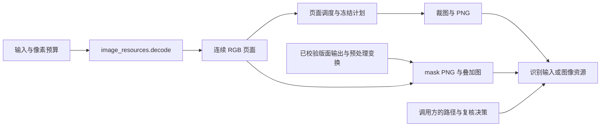

# 图像与资源生成

第 6 项结构优化将输入解码、RGB 裁图、PNG、mask 回映和版面叠加图集中到 `image_resources` 模块。`page_pipeline`、`page_execution` 与 `page_identity` 分别负责预算/提交、裁框/生成时机和资产身份，图像模块只返回 RGB 或 PNG 数据，不写文件、不决定内容归属或作业状态。



## 文件职责

| 文件 | 职责 |
|---|---|
| `src/image_resources.hpp` | 显式像素预算的解码入口、RGB/PNG 裁图、版面光栅来源及两种诊断资源入口 |
| `src/image_resources.cpp` | STB 输入解码与 PNG 编码、原像素裁剪、reference/smart mask 回映、原序叠加图绘制 |
| `src/layout_output.cpp` | 拥有原始张量并提供受控 mask 读取；RLE 仍在该模块生成 |
| `src/page_pipeline.cpp` / `src/page_execution.cpp` | 输入预算、资源生成时机与提交；身份/路径由 `page_identity` 提供，复核由 `candidate_review` 处理 |
| `tests/image_resources.cpp` | 通过实际入口核对输入、裁图、编码像素、两种 mask 采样及叠加顺序 |

## 输入与所有权约定

- `decode(InputView, pixel_limit)` 检查输入并返回可选的连续 RGB8 页面；不设置默认模型预算。失败仍由调用方映射为 `InputError`。
- RGB/GRAY 输入的 padding 被跳过，最后一行只需有效像素，不要求尾部 padding。灰度输入复制到三个通道，原始输入不变。
- PNG/JPEG 必须与文件头匹配，编码数据最多 64 MiB，不能同时携带尺寸或 stride。解码前检查像素预算；保持单通道/三通道、8-bit 的既有支持范围。
- `crop` 和 `crop_png` 使用页面内的半开框逐行复制，不缩放、不静默 clamp，也不改写原图。新入口明确拒绝无效 RGB 缓冲区或非法裁框，抛出 `std::invalid_argument`。
- `LayoutRasterSource` 只组合原页尺寸、已校验输出和预处理变换的只读引用，调用期间须保持有效，候选与来源须属于同一页。
- mask PNG 返回整页灰度 0/255 图；原始 mask 的所有权及字节访问继续由解码模块管理。诊断与候选复核使用同一采样实现，编码用途只影响原有失败文案。
- smart overlay 使用有效的预处理 preview；reference overlay 使用原图。原图、preview、候选及原始 mask 均不被绘图修改。

## 保持的像素规则

reference mask 先将原浮点 `box` 向零截断为整数，再按 `nearbyint(coord*200/page_size)` 计算 mask 范围，使用原来的整数比例采样。它不使用扩大后的识别裁框，也不改成按 `crop` 或 floor 采样；退化映射返回全零页。

smart mask 只在原候选 `crop` 内绘制，采样 `int(((coordinate+0.5)*scale+pad)/4)` 并限制到 `[0,199]`，保持原像素中心与 padding 规则。

叠加图按原候选存储顺序绘制，仅处理 selected 候选。每个候选先绿色混色，再画红边框，重叠区域继续逐次混色。smart 分支在 preview 上按原 `model_box` floor/ceil 绘制，并直接用 preview 坐标除以 4 读取 mask；reference 分支使用原页和页面 mask。

RGB PNG、叠加图、复核 mask 与诊断 mask 的四种编码错误文本原样保留。公共 STB 实现从 `core.cpp` 移入本模块，宏保持不变；独立测试探针与 MNN adapter 的局部实现继续按原链接方式使用。

## 验证

直接入口测试覆盖 padded RGB、最短末行、GRAY 展开、像素预算及非法输入、PNG/JPEG 和格式错配、编码元信息、截断/alpha/16-bit 拒绝、非法裁框、裁图和 PNG 像素一致性、源图不变性。mask 测试锁定 reference 小数框截断与采样、smart 像素中心与 padding、复核与诊断字节一致；overlay 测试核对原序重复混色、红边框、筛除候选跳过和 smart preview。

2026-10-11 本轮 Release 无模型构建的 40 项 CTest 全部通过；新增入口另通过 AddressSanitizer 内存检查。53 组重构前后端到端输出一致：28 组识别、5 组结构及 20 组筛选场景；排除实际耗时字段后，完整 DocumentIR、Markdown 与全部资源 SHA256 一致，48 组核对 JSON 文本格式、28 组核对 run-manifest，预算字段参与比较。

本轮 `core.cpp` 从 860 行减少到 681 行。构建环境见 [页面计划验证](page-plan.md)，直接测试可单独运行：

```sh
ctest --test-dir /tmp/docprase-page-plan-check -R '^image_resources$' --output-on-failure
```

本轮验证结构与行为兼容，未评测模型准确率、推理性能或 Android 真机表现。
