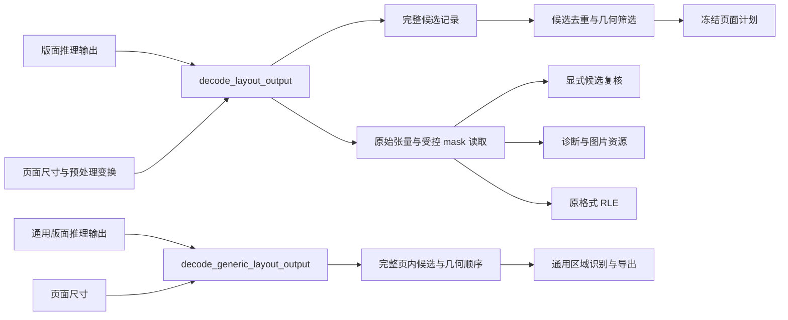

# 版面输出解码

第 5 项结构优化把 PP-DocLayoutV3 的输出张量契约、坐标回映、初始候选筛选、mask 读取与 RLE 编码集中到 `layout_output` 模块。调用方通过 `decode_layout_output(TensorOutput, LayoutDecodeOptions)` 将模型结果移动交接，取得候选与拥有原始张量的解码结果；非法输出返回空结果。

第 7 轮继续收拢通用后端 `layout_candidates` 的张量解码、整页裁框检查及几何排序。`decode_generic_layout_output(TensorOutput, width, height)` 返回拥有候选数据的完整结果；两种模型输出分别保持各自类别映射和失败规则，调用方无需了解张量字段。



## 文件职责

| 文件 | 职责 |
|---|---|
| `src/layout_output.hpp` | 两种输出的解码入口、通用候选、PP 解码选项、拥有张量的成功结果和只读 mask 行 |
| `src/layout_output.cpp` | 各格式的张量与数值契约；通用页内框与几何排序；PP 坐标回映、初始原因、全量 mask 校验和 RLE |
| `src/layout_filter.cpp` | 已解码候选的 NMS、大图片、包含和外层重叠筛选 |
| `src/layout_inference.cpp` / `src/page_pipeline.cpp` | 组装请求、执行推理与解码、映射错误；pipeline 组合筛选/复核/规划/执行阶段 |
| `src/image_resources.cpp` | 基于受控 mask 行进行页面回映、叠加图绘制和 PNG 资源生成 |
| `tests/layout_output.cpp` | 直接解码入口的契约与排序测试；页面交接、取消与失败审计；PP mask、来源、移动及 RLE |

## 所有权与访问约定

- 成功结果拥有完整原始 `TensorOutput`。调用方移动交接；结果允许移动，禁止复制，避免无意复制 48 MB mask。
- 内部保存张量索引，在访问时从当前成员取得缓冲区，不缓存指向自身成员的指针。移动构造、移动赋值和将候选移交筛选后，原始来源仍可读取。
- `candidates` 保留原行身份和诊断信息。`tensors()` 提供只读原始张量，用于保存候选及数量资源，包括未使用的浮点行。
- `mask_row(index)` 提供只读行视图，`pixel(index)` 检查像素边界；`candidate_row_bytes(index)` 返回有效候选的原 7 个 float 字节。越界访问抛出 `std::out_of_range`。
- 原始字节视图仅在持有缓冲区的结果存活期间有效，不得在销毁或覆盖该结果后使用。读取 int32 继续采用 `memcpy`，不假定字节缓冲区对齐。
- 候选复核仍按 `crop` 描述、原始模型行、完整原始 mask 行建立绑定。回映后的框或压缩后的 mask 不替代原字节证据。
- RLE 由解码结果生成，魔数、维度、小端长度、全部 300 行及运行长度格式保持原实现。图片 mask 回映、叠加图和 PNG 创建由 `image_resources` 处理，执行流程决定资源身份和生成时机。

## 保持的 PP-DocLayoutV3 解码契约

输出恰好包含 `fetch_name_0/1/2` 三个张量，顺序任意；名称、dtype、Matrix 布局、形状和字节数严格匹配原契约。数量范围为 `[0,300]`，只校验数量范围内的浮点行；尾部浮点行原样保留，不新增有限值检查。

有效行的 class 与 rank 保持原整数范围，rank `-1` 合法，未知类别记为 `unknown`。模型框先保存，再按实际预处理参数逆映射为页坐标。分数阈值继续按 `float(score_threshold)` 比较；低分、退化、页外、范围过大及空裁框的原因优先级不变。合法裁框先 clamp，再将左上 floor、右下 ceil，原浮点框不改写。

全部 300 行 mask 的每个 int32 必须为 0 或 1，包括低分候选、无效框及未使用行。未使用行可以非零；空页仍检查完整 mask。候选的 `mask_nonzero` 是该原始行的非零总数。

非法模型输出仍映射为原 `layout_output_contract_mismatch` 错误，推理异常、错误 payload 和取消继续由执行流程处理。本轮不改变几何筛选、内容归属、识别或导出策略。

## 通用后端输出契约

`decode_generic_layout_output` 借用原始张量，只复制解码后的候选字段，成功结果不依赖输入张量寿命。输出必须恰好是一个 `layout_candidates` Float32/Matrix 张量，形状 `{N,7}`、`N∈[0,10000]`，字节数严格一致；`N=0` 是合法空页，不能与解码失败混淆。

每行数值必须有限。class/rank 是 `[0,1000000]` 整数，分数是 `[0,1]`，四个框坐标是 `[-1000000,1000000]` 整数。class `0/1/2/3` 映射为 text/formula/table/image，其他合法 class 保留为 unknown；不使用 PP 类别表，rank `-1` 在该格式中非法。

所有框必须在页面内且面积为正。任一张量、数值或裁框非法均返回空结果，不 clamp、不过滤坏候选、不暴露部分结果。零分候选与未知类别仍保留；不套用 PP 的阈值或几何筛选策略。

成功候选继续采用 `std::sort`，按 `y0 → x0 → y1 → x1 → label` 排序，不使用模型 rank/score，也不改成稳定排序。页面调度继续负责请求、进度、审计和状态：`layout_completed` 发生在候选校验前，非法输出仍返回原空审计 `Failed`；合法空页导出 `Blank`，不记作执行了识别。

计时约定有一项调整：通用路径的 `recognition_ms` 现在从完整解码成功后开始，不再包含原来放在主流程中的裁框校验和排序耗时。此次输出对照不比较实际耗时；不能据此宣称识别加速。预算与模型参数不变。

## 第 5 轮验证

直接入口测试覆盖张量任意顺序、缺失/重复/额外输出、每类 dtype/布局/形状/字节数错误、数量边界、非法数值、rank 与分数边界、原因优先级、clamp 与回映、有效/低分/未用/空页 mask、未使用浮点行、原始证据和越界访问。RLE 测试按预期字节序列核对全零、全一、首尾点、交替位与未使用行。

所有权测试核对移动前后原 mask 缓冲区地址相同，并验证移动赋值和候选移交后读取仍有效。直接入口另以 AddressSanitizer 和 UndefinedBehaviorSanitizer 检查。

2026-10-11 本轮 Release 无模型构建的 39 项 CTest 全部通过。53 组重构前后端到端输出一致：28 组识别结果、5 组结构和 20 组筛选场景；排除实际耗时字段后，完整 DocumentIR、Markdown 与全部资源 SHA256 一致，其中 48 组核对 JSON 文本格式、28 组核对 run-manifest，预算字段参与比较。

本轮 `core.cpp` 从 982 行减少到 860 行。构建环境见 [页面计划验证](page-plan.md)，直接测试可单独运行：

```sh
ctest --test-dir /tmp/docprase-page-plan-check -R '^layout_output$' --output-on-failure
```

本轮验证结构与行为兼容，未评测真实模型质量、推理性能或 Android 真机表现。

## 第 7 轮验证（2026-10-11）

扩展同一个直接入口测试，覆盖通用输出数量、名称/dtype/布局/形状/字节数错误、所有字段 NaN/Inf、整数与数值范围、rank `-1`、页外/退化框整页失败、空页和 10000 行上限、未知类别、零分、来源不变、成功结果所有权及每一级排序。新增页面交接测试覆盖 `layout_completed` 回调取消的空/非空页、坏张量/坏框遇到取消仍按旧规则失败、错误 payload 的进度事件、fresh Failed 审计，以及空页成功导出且不执行识别。

Release 完整构建通过，40 项 CTest 最终全部通过。首次并行运行有 1 项 `formula_revalidation_integration` 在最后一个有效公式案例导出时报错，单独复跑通过；该首次失败原因未定位，不将其归因于本轮解码改动。新增页面交接断言随后单独复验通过。直接解码测试通过 AddressSanitizer 和 UndefinedBehaviorSanitizer。

65 组重构前后 `run_page` 对照一致，包含正常、空页、全部类别、PDF 页身份、取消、非法张量、非有限数值、整数/范围边界及非法框：比较作业状态、非耗时审计字段、完整进度与请求序列、reset 次数、DocumentIR/Markdown 原文本及所有资产 SHA256。原 PP 解码实现与其余源文件经字节/SHA256 检查保持不变。

`core.cpp` 从 681 行减少到 636 行。源码快照与对照证据位于本机临时目录 `/dev/shm/docprase-generic-layout-0itqun0a`；永久回归入口仍为 `tests/layout_output.cpp`，构建方式沿用前述说明。本轮只修改 docprase 源仓库，不同步 Android 快照或发布 APK。
