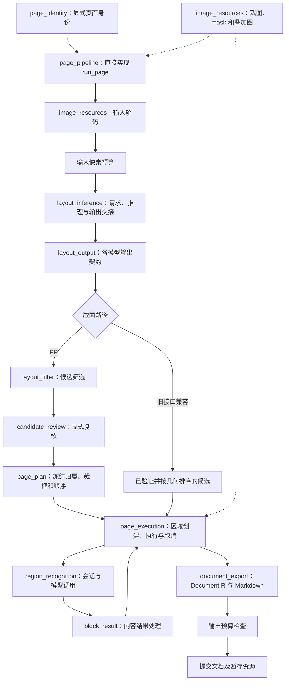

# 页面 pipeline 与模块组合

第 8 轮结构优化将剩余页面身份、显式候选复核、版面推理和区域执行从 `core.cpp` 分离，由 `page_pipeline` 组合各阶段。公共 `run_page` 入口直接由 `page_pipeline.cpp` 实现；后续删除了 10 行的 `core.cpp` 转发文件及重复入口声明，不再执行额外转发或保存隐式页号。



## 文件职责

| 模块 | 对外 interface 与责任 |
|---|---|
| `page_pipeline` | 直接实现公共 `run_page`，页面阶段组合、输入/输出预算、全页状态、导出和最终资源提交 |
| `page_pipeline_context.hpp` | 同步阶段借用的后端、像素、身份、只读配置、取消标志和进度回调；不保存跨页状态 |
| `page_identity` | 图片/PDF 身份差异、请求/块/资源命名及原 RGB 文档哈希 |
| `layout_inference` | 两种路径的能力检查、预处理选择、模型请求、推理与错误交接；委托 `layout_output` 解码 |
| `candidate_review` | 精确页面/候选/mask 绑定、保护内容与确认跳过；返回证据和资源，不操作作业审计 |
| `page_execution` | 按冻结计划或通用候选顺序创建块、调用识别、维护后端可用性、区域进度和取消优先级 |
| `region_recognition` | PP 的受控重试与通用后端的单次 reset/execute，分别保持异常规则 |
| `block_result` | PP 与通用内容结果分别规范化，维护完成/截断、UTF-8 和原始字节契约 |
| 既有模块 | `image_resources`、`layout_output`、`layout_filter`、`page_plan`、`document_export` 继续承担原职责 |

pipeline 是现有阶段的固定组合；未引入运行时阶段注册、插件框架或共享可变单例。通用和 PP 输出具有实际不同的 adapter 契约，保留两条明确路径，通过既有模块的 interface 组合。这使格式、复核、内容处理和执行规则各自具有 locality，而非仅把原 `core.cpp` 改名。

## 所有权与提交时机

每次 pipeline 调用独立持有解码图像、`PageIdentity`、预处理 preview/变换、完整模型张量、候选记录和冻结页面计划。阶段借用它们的引用，不在调用外保存；`LayoutRasterSource` 的来源覆盖 mask、overlay 和导出整个使用期。页面身份不再依赖 `thread_local`，嵌套调用与独立后端的并行页面均有独立命名。

`PageExecutionResult` 显式返回 `completed`、blocks、暂存 assets、完整 audit 和区域进度计数。PP 先按计划创建全部块与裁图，再按独立识别顺序执行；通用路径保持逐候选创建和识别。执行只更新候选的资源/裁框诊断，不重算内容归属或三份顺序。

PP 布局早退保持原审计和输入 tensor 诊断资产；开始执行前，资产移入暂存输出。执行取消不提交暂存的裁图或诊断图；导出后超过输出预算也不提交。只有完整结束且预算通过，pipeline 才把 JSON、Markdown 和 assets 赋给最终 `audit.output`。因此取消不是把已经创建的资源统一发布。

## 保持的路径差异

- 通用非法布局仍返回 fresh Failed，丢弃先前审计；PP 契约失败保留审计和 `layout_output_contract_mismatch`。
- 通用 `layout_completed` 在输出校验之前；PP 在解码、筛选和复核之后。各阶段原取消检查与进度顺序保持。
- PP 布局异常保留专用错误及输入诊断；通用布局异常继续向上层传播。两种区域异常仍分别保存详情或固定旧错误文本，`bad_alloc` 重抛。
- PP 可按既有规则重试；通用保持单次生成，不应用 PP 的视觉证据及内容规范化规则。
- 首次区域失败仅在后续取消时影响终态优先级；正常完成但有区域失败仍是 Partial，不升级为整页 fatal。
- PP 依据全量候选判断 blank；有候选但全部筛除仍为 partial。通用空候选仍成功导出 blank。
- PP 耗时按区域累计，通用按执行阶段记录；本轮输出比较排除实际耗时，不宣称性能收益。

## 验证（2026-10-12）

Release 完整构建通过，**41/41 CTest 在一次串行运行中全部通过**，包括上一轮曾出现首次导出失败的 `formula_revalidation_integration`。本轮没有改动该公式测试或导出文件写入逻辑，此次通过不代表已修复其此前的偶发失败。

**118 组新旧对照一致**：65 组通用 pipeline 状态/异常/进度/请求/审计，28 组识别结果与 manifest，5 组页面结构，20 组候选筛选。比较非耗时 DocumentIR、Markdown、资产身份/顺序与 SHA256，部分对照还核对完整 JSON 文本。新的 `tests/page_pipeline.cpp` 通过当前 pipeline 和旧核心的临时兼容入口各运行一次，锁定关键交接规则。

新增测试覆盖嵌套/并行页面身份、图片/PDF 命名、PP 布局异常/非法输出/取消时保留输入诊断、执行取消不发布暂存资源、两种输入/输出预算、全筛除页面、先失败再取消、reset/推理/错误 payload 后的区域隔离，以及两种原错误文本。pipeline 测试与全部核心依赖经 AddressSanitizer 和 UndefinedBehaviorSanitizer 构建运行通过。

**Android arm64-v8a JNI 编译与链接通过**：隔离构建使用 Android 项目现有 CMake/适配源码、固定 MNN 和 NDK `28.1.13356709`，通过 `DOCOCR_SOURCE_ROOT` 直接引用当前 docprase；平台 android-26，Release，相关源文件实际编译参数含 `-O3 -DNDEBUG`。产物为 AArch64 的 `libdococr_jni.so`、`libdococr_c.so`、`libMNN.so` 和 `libllm.so`，JNI 导出存在。没有同步 Android 快照、生成/发布 APK 或执行真机 OCR；此项验证覆盖原生集成的编译链接。

本机证据目录 `/dev/shm/docprase-page-pipeline-75a9g6tq` 保存源码快照、118 组对照、CTest/内存检查日志、Android 配置/构建日志与 `android-verification.json`。这些是临时证据，永久回归入口为 `tests/page_pipeline.cpp`。

无模型回归可用：

```sh
cmake -S . -B /dev/shm/docprase-pipeline-check \
  -DCMAKE_BUILD_TYPE=Release -DDOCOCR_BUILD_TESTS=ON \
  -DDOCOCR_MNN_ROOT=/tmp/docprase-no-mnn -DPython3_EXECUTABLE=/usr/bin/python3
cmake --build /dev/shm/docprase-pipeline-check -j2
ctest --test-dir /dev/shm/docprase-pipeline-check --output-on-failure
```

删除转发层后重新构建并执行完整 CTest：41/41 一次通过（92.52 秒），覆盖公共入口、PDF、取消、错误、预算与导出。

“通用”仅指旧 `layout_candidates` 接口兼容路径，主要供测试使用；生产识别为 PP-DocLayoutV3 版面分析与区域 VLM 组合，PP-Structure 尚未实现。

## App 接入与发布

用户已授权删除转发层、同步 Android 原生源码快照、构建两版 APK 并提交发布。`run_page` 保持签名，由 pipeline 直接实现；静态库 `dococr_core` 继续用于链接模块。Android 发布与验证记录在宿主仓库的 `verification/docparse-pipeline/DELIVERY.md`。
